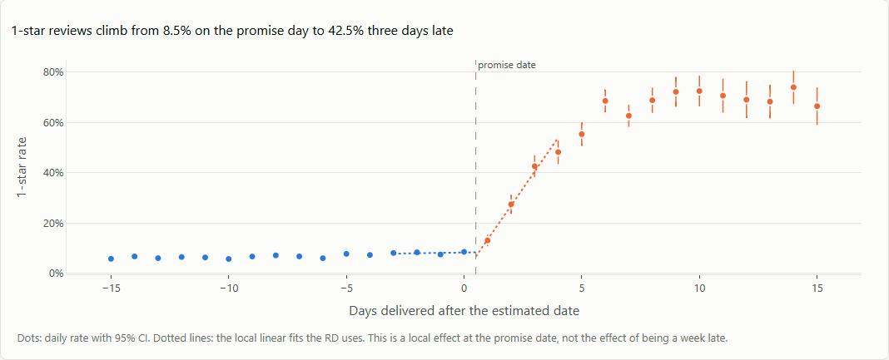
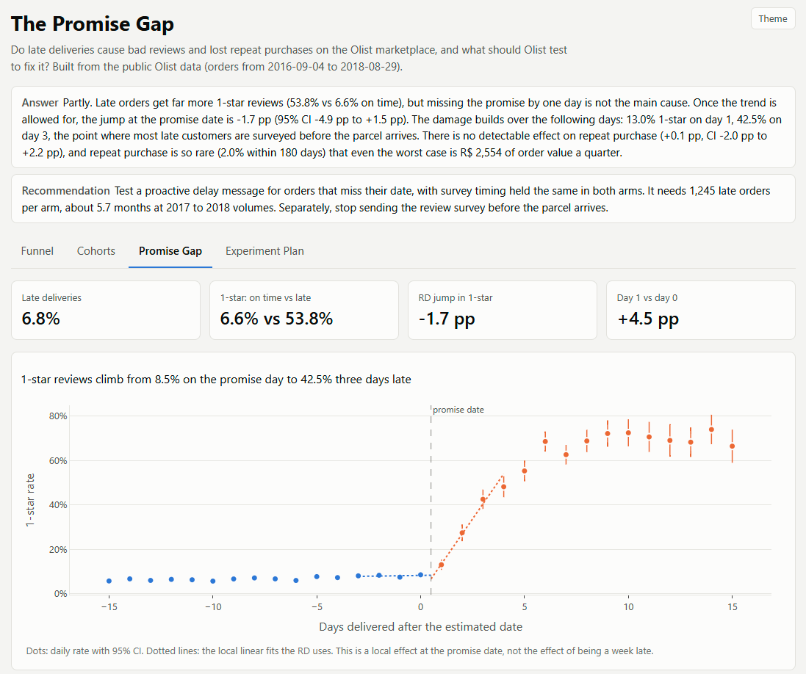
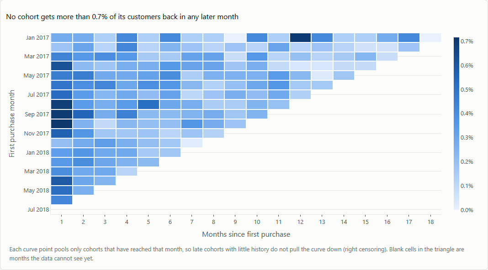
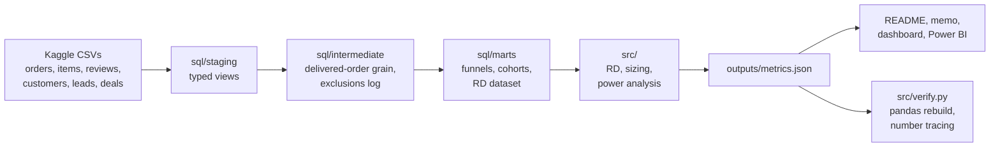

# The Promise Gap

**Do late deliveries cost an online marketplace its reviews and its repeat customers?**
An end-to-end analysis of 99,441 real orders from Olist, a Brazilian marketplace
integrator: SQL data model, funnels, cohort retention, a causal regression discontinuity, a costed
recommendation and a powered A/B test design.


**[Live dashboard](https://tharun0127.github.io/broken-promises-olist/)** ·
**[One-page memo](docs/memo.md)** ·
**[Full RD results](docs/promise_gap_results.md)** ·
**[Walkthrough notebook](notebooks/walkthrough.ipynb)**



---

## Question, answer, recommendation

**Question.** Do late deliveries cause bad reviews and lost repeat purchases on Olist, and what should
Olist test to fix it?

**Answer.** Partly, and not in the way the simple comparison suggests.

- Late orders get far more 1-star reviews: **53.8%** against **6.6%** on time.
- But missing the promise by one day is not a cliff. Once the trend is allowed for, the jump at the
  promise date is **-1.7 pp** (95% CI -4.9 pp to +1.5 pp).
- The damage builds over the next days: 8.5% 1-star on the promise day,
  13.0% on day 1, **42.5% on day 3**. Day 3 is exactly when most late
  customers (70.2%) get the review survey before their parcel arrives.
- Repeat purchase does not measurably move (+0.1 pp, CI -2.0 pp to
  +2.2 pp). Only 2.0% of customers return within 180 days, so even the
  worst case is **R$ 2,554** of order value a quarter.

**Recommendation.** Test a proactive delay message, sent the day after a missed date, randomised by
customer, with survey timing held the same in both arms. It needs **1,245 late orders per arm,
about 5.7 months**. Separately, stop sending the review survey before the parcel arrives.

## Why this question matters

A delivery date shown at checkout is a promise. 6.8% of Olist's delivered orders broke it. The
obvious response is "deliver faster", which is expensive. Before spending on logistics, a business needs to
know three things: how much a late delivery actually hurts, where in the delay the damage happens, and
whether a cheaper fix (better communication) could recover some of it. This project answers the first two
from data and designs the test for the third.

## Limitations

Read these before the results. They are the questions a careful reviewer should ask.

- **The causal estimate is local.** It measures a one-day miss of the promise date, not a week-late order.
- **Two validity checks partly fail.** Fewer orders arrive just after the promise date than just before
  (count ratio 0.68), and 3 of 14 pre-delivery
  covariates jump at the line. The two sides are not perfectly comparable, so the estimate is reported as
  suggestive, with a donut check and a day 1 vs day 0 comparison alongside it.
- **Repeat purchase is too rare to measure precisely.** A null here means "cannot detect", not "no effect".
- **Review timing is partly mechanical.** 74.5% of late-order reviews were sent before
  delivery, so a late order's 1-star partly rates the wait, not the product.
- **No margin or commission data.** Money is order value paid by customers, not Olist revenue.
- **Historic data** (2016-09-04 to 2018-08-29). The all-time repeat rate is a lower bound; the 180-day rate and
  cohort curves use only fully observed customers and months.
- **The A/B test is a design.** Nothing was run.

## Judgement calls

The decisions that shaped the result, and why. Each one is logged with alternatives in
[DECISIONS.md](docs/DECISIONS.md).

1. **Customer = `customer_unique_id`, not `customer_id`.** The dataset has 99,441 `customer_id` values,
   one per order, for 93,350 people with a delivered order. Using the obvious key would make every
   customer a one-time buyer and the repeat rate zero by construction.
2. **Lateness measured in whole calendar days.** The estimate is a date, not a time. A parcel arriving in the evening
   on the promised day kept its promise; fractional days would have called it late and moved the cutoff.
3. **Two estimates shown, not one picked.** The local linear RD (-1.7 pp) and the day 1 vs
   day 0 comparison (+4.5 pp) answer slightly different questions when the curve
   bends sharply. Reporting only the more dramatic number would have been easy and wrong.
4. **Censoring handled, not ignored.** Customers acquired near the end of the data have had no time to return.
   Unobservable cohort cells are left empty, and rates use only fully observed windows.
5. **1-star rate, not repeat purchase, as the experiment's primary metric.** Repeat purchase is the outcome the
   business cares about most, but detecting a realistic change would need 104,314 first
   orders per arm. A test that cannot finish is not a plan.
6. **A small money number reported as small.** The worst case is R$ 2,554 a quarter. The
   memo says so and redirects attention to reviews, rather than stretching assumptions to make the number bigger.

## What surprised me

I expected a sharp jump in bad reviews the moment an order became late. There was none once the trend was
modelled. The rise starts on day 1 and steepens on day 3, and day 3 is when Olist's review survey starts
reaching late customers before their parcel does (6.0% on day 2,
70.2% on day 3). Part of what looks like delivery damage is a measurement choice:
asking customers to rate an order they do not have yet. That turned a logistics question into a much cheaper
recommendation.

---

## What this project demonstrates

| Skill | What I did | Where |
|:--|:--|:--|
| **SQL data modelling** | Three-layer DuckDB model (staging, intermediate, marts), one concept per CTE, typed and documented | `sql/` |
| **Data quality** | Profiled keys, join cardinality, nulls and duplicates; logged every exclusion with row counts | [data_profile.md](docs/data_profile.md), [exclusions.md](docs/exclusions.md) |
| **Choosing the right grain and key** | One row per delivered order; customers by `customer_unique_id`, without which the repeat rate is zero by construction | `sql/intermediate/04_int_delivered_orders.sql` |
| **Funnel analysis** | Fulfilment and seller acquisition funnels with conditional aggregation and `GROUPING SETS` | `sql/marts/02_*.sql`, `sql/marts/03_*.sql` |
| **Cohort retention** | Monthly cohorts with `ROW_NUMBER`, `LAG` and date bucketing; right censoring handled explicitly | `sql/marts/04_*.sql`, `src/cohorts.py` |
| **Causal inference** | Regression discontinuity: cross-validated bandwidth, robustness, placebo, density and balance checks | `src/rd.py`, [promise_gap_results.md](docs/promise_gap_results.md) |
| **Business sizing** | Effect and its confidence interval turned into money per quarter, every assumption written down | [assumptions.md](docs/assumptions.md) |
| **Experiment design** | Hypothesis, randomisation unit, guardrails, power from measured baselines, pitfalls | [experiment_design.md](docs/experiment_design.md) |
| **BI and dashboards** | Power BI star schema with commented DAX and build guide; interactive four-page Plotly dashboard | `powerbi/`, [index.html](docs/index.html) |
| **Reproducibility and testing** | One command rebuilds everything; pytest known-answer tests; SQL cross-checked in pandas | `run_all.py`, `tests/`, `src/verify.py` |
| **Communication** | One-page memo with ranked, sized recommendations; honest limitations | [memo.md](docs/memo.md) |

## Key results

| Metric | Value |
|:--|--:|
| Orders analysed | 99,441 |
| Orders that reach the customer | 97.0% |
| Delivered orders that were late | 6.8% |
| Customers (people, not order IDs) | 93,350 |
| Customers who ever buy again | 2.2% |
| Customers who buy again within 180 days | 2.0% |
| 1-star rate: on time vs late | 6.6% vs 53.8% |
| RD jump in 1-star rate at the promise date | -1.7 pp (CI -4.9 pp to +1.5 pp) |
| Day 1 vs day 0 difference in 1-star rate | +4.5 pp |
| RD jump in mean review score | -0.09 (CI -0.22 to +0.04) |
| RD jump in 180-day repeat purchase | +0.1 pp (CI -2.0 pp to +2.2 pp) |
| Repeat order value at risk per quarter (low / base / high) | R$ -2,846 / R$ -146 / R$ 2,554 |
| Seller leads that close / closed sellers that ever sell | 10.5% / 44.7% |
| Experiment: 1-star from 56.0% to 50.4% | 1,245 per arm, 5.7 months |

Negative money means the scenario implies late orders gain repeat value. See [assumptions.md](docs/assumptions.md).

## Dashboard

Four pages: Funnel, Cohorts, Promise Gap and Experiment Plan. Every chart title states its takeaway and is
generated from the data. A Power BI version can be rebuilt from `powerbi/` using the
[build guide](powerbi/POWERBI_BUILD_GUIDE.md).



Retention is the other side of the story. Almost every sale comes from a new customer:



## How it works



1. **Profile** every table: keys, join cardinality, nulls, duplicates, status and date coverage.
2. **Model** in DuckDB SQL. The grain is one row per delivered order (96,470 rows).
3. **Funnels** for order fulfilment and seller acquisition.
4. **Cohorts** with explicit right censoring: unobservable cells stay empty, not zero.
5. **Regression discontinuity** at the promise date. Local linear, triangular kernel, bandwidth
   4 days by cross-validation, robustness at 2 and 8 days,
   uniform kernel, donut, placebo cutoffs, density test and covariate balance.
6. **Sizing** of repeat revenue at risk, low / base / high from the confidence interval.
7. **Experiment design**, powered on baselines measured in this data.

## Built to be trusted

- **One command rebuilds everything** from raw data: `python run_all.py`. A rebuild from a fresh clone
  reproduces every output file byte for byte.
- **SQL is cross-checked in pandas.** Funnel conversion, repeat rates and every observed cohort cell are
  recomputed independently from the raw CSVs and must match within 1e-6.
- **Known-answer tests.** The real SQL runs on a small hand-built dataset where every answer was worked
  out on paper; the RD code is tested on inputs with a known effect.
- **No hand-typed numbers.** This README, the memo and the interview guide are rendered from templates,
  and a check fails the build if any number in them does not come from `outputs/metrics.json`.
- **Every decision is written down** with its reason: [DECISIONS.md](docs/DECISIONS.md).

## How to reproduce

Requires Python 3.11 and a Kaggle account.

```bash
git clone https://github.com/Tharun0127/broken-promises-olist.git
cd broken-promises-olist
python -m venv .venv
.venv/Scripts/activate            # Windows. On macOS or Linux: source .venv/bin/activate
pip install -r requirements.txt

# Download the data (needs Kaggle credentials in ~/.kaggle/)
kaggle datasets download -d olistbr/brazilian-ecommerce -p data/raw --unzip
kaggle datasets download -d olistbr/marketing-funnel-olist -p data/raw --unzip

python run_all.py                 # rebuilds outputs/, docs/, README.md, powerbi/data/ and the notebook
pytest                            # known-answer tests
```

## Repository layout

```
sql/staging        typed, renamed views over the raw CSVs
sql/intermediate   reviews, order items, the delivered-order grain, exclusions
sql/marts          funnels, cohorts, the RD dataset
src/               Python steps called by run_all.py
tests/             pytest known-answer tests
outputs/           every computed table and metrics.json
docs/              memo, results, decisions, assumptions, experiment design, dashboard
powerbi/           measures.dax and the build guide (CSVs are generated into powerbi/data/)
notebooks/         executed walkthrough notebook
```

## What I would do next

With access inside Olist, these would close the gaps this public data leaves open:

- **Run the delay-message test** and read the 1-star rate after the planned sample, not before.
- **Get checkout data** to measure what a padded delivery estimate costs in conversion. That would decide
  between "promise later" and "communicate better".
- **Join review scores to later seller sales** to put a money value on a bad review, the cost this data cannot price.
- **Add commission rates** to turn order value into Olist revenue.
- **Look at lateness by seller and carrier**, not only by state, to find the few routes behind most 3+ day delays.

## Further reading

- [Memo](docs/memo.md): the answer and three ranked, sized recommendations on one page.
- [RD results](docs/promise_gap_results.md): every estimate, check and table.
- [Experiment design](docs/experiment_design.md): hypothesis, unit, metrics, power, pitfalls.
- [Technical deep dive](docs/INTERVIEW_PREP.md): how each part works, line by line, likely questions, and
  where the analysis is weakest.

---

Author: [Tharun](https://github.com/Tharun0127). Data: Olist, Brazilian E-Commerce Public Dataset and
Marketing Funnel dataset on Kaggle (CC BY-NC-SA 4.0). Questions and feedback are welcome in the issues.
